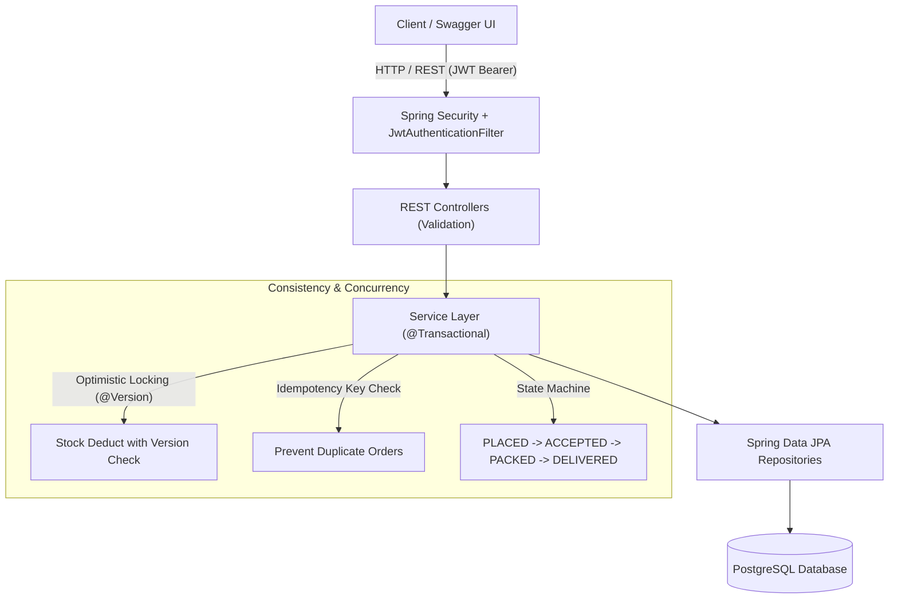
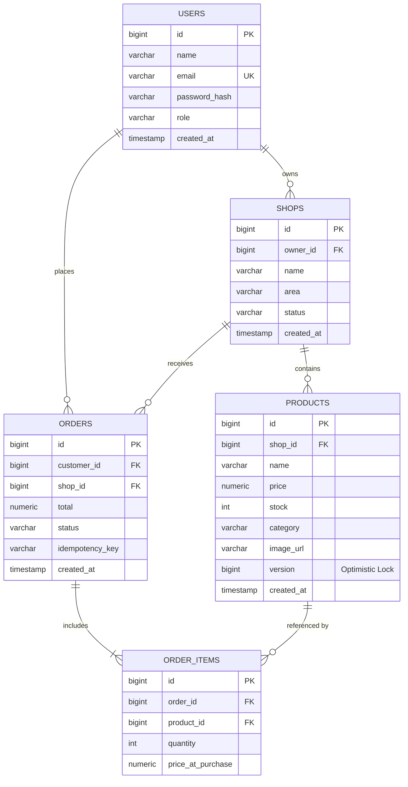

# Local Shops Marketplace

A production-grade multi-vendor neighborhood marketplace backend built with **Spring Boot 3**, **Spring Security + JWT**, and **PostgreSQL**. Neighborhood shops register and manage their product catalogs while local customers discover shops, search products, and place orders with strict concurrency guarantees against overselling.

---

## Architecture & Data Flow



---

## Entity Relationship (ER) Diagram



---

## Key Engineering Features

1. **Optimistic Locking (`@Version`)**:
   - `Product` entity uses Hibernate `@Version` to prevent overselling under high concurrency.
   - Tested under parallel load (`OrderConcurrencyTest`): multiple simultaneous checkout threads compete for the last item; exactly 1 succeeds and remainder fail cleanly without negative stock.
2. **Idempotent Order Creation**:
   - Accepts an `Idempotency-Key` header.
   - Retried checkout requests return the original processed order instead of double-deducting stock or creating duplicate charges.
3. **Strict Order State Machine**:
   - Only valid transitions are permitted:
     - `PLACED -> ACCEPTED -> PACKED -> DELIVERED`
     - `PLACED -> CANCELLED`
     - `ACCEPTED -> CANCELLED`
   - Cancelling an order automatically restores inventory back to the product stock.
4. **Single-Shop Order Constraint**:
   - Customers cannot order from multiple shops in a single checkout, maintaining merchant fulfillment boundaries.
5. **No N+1 Queries**:
   - Order queries use `JOIN FETCH` on `order.items` and `item.product`.
6. **JWT Stateless Authentication**:
   - HMAC-SHA256 signing with 24-hour token expiration, parsed via `JwtAuthenticationFilter`.
   - Role-based authorization (`@PreAuthorize("hasRole('SHOP_OWNER')")`, etc.).

---

## API Overview

Interactive Swagger UI: **`http://localhost:8080/swagger-ui.html`**

### Auth Endpoints
- `POST /api/auth/signup` - Register a customer or shop owner
- `POST /api/auth/login` - Authenticate and obtain JWT
- `GET /api/auth/me` - View current user profile (Authenticated)

### Shop Endpoints
- `POST /api/shops` - Register a shop (Status starts as `PENDING`) [`SHOP_OWNER`]
- `GET /api/shops` - List approved shops (Area filter, paginated) [Public]
- `GET /api/shops/{id}` - Get shop details [Public]
- `PATCH /api/admin/shops/{id}/approve` - Approve shop [`ADMIN`]
- `PATCH /api/admin/shops/{id}/reject` - Reject shop [`ADMIN`]

### Product Endpoints
- `POST /api/shops/{shopId}/products` - Add product to approved shop [`SHOP_OWNER`]
- `PUT /api/products/{id}` - Update product [`SHOP_OWNER`]
- `DELETE /api/products/{id}` - Delete product [`SHOP_OWNER`]
- `GET /api/products/{id}` - View product details [Public]
- `GET /api/products` - Search products by keyword, category, area, price range [Public]
- `POST /api/products/{id}/image` - Upload product image [`SHOP_OWNER`]
- `GET /api/products/images/{filename}` - Serve product image [Public]

### Order Endpoints
- `POST /api/orders` - Place order with idempotency protection [`CUSTOMER`]
- `GET /api/orders/my` - Customer order history [`CUSTOMER`]
- `GET /api/shops/{shopId}/orders` - Incoming orders for shop [`SHOP_OWNER`]
- `PATCH /api/orders/{id}/status` - Advance order lifecycle [`CUSTOMER` / `SHOP_OWNER`]

---

## Demo Accounts (Pre-seeded on startup)

| Role | Email | Password |
|---|---|---|
| **Platform Admin** | `admin@localshops.com` | `Password@123` |
| **Shop Owner** | `owner@localshops.com` | `Password@123` |
| **Customer** | `customer@localshops.com` | `Password@123` |

---

## Running Locally

### 1. Run Tests
```bash
cd backend
./mvnw test
```

### 2. Run the Application
```bash
cd backend
./mvnw spring-boot:run
```

Open Swagger UI in your browser:
**`http://localhost:8080/swagger-ui/index.html`**
Click **Authorize** (top right) and paste your JWT from `/api/auth/login` to explore protected endpoints.
